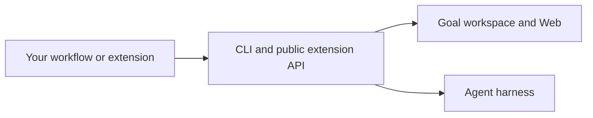

<p align="center"><a href="https://github.com/game-dev-rta-club/chill-agent-cli/actions"></a>  </p>

# chill-agent-cli

Local workspace infrastructure for developers building agent workflows. Use its CLI, Web interface, and agent connections independently of the chill-agent skills and continuation policy.

The same workspace connects to **Codex Desktop** and **Claude Code**. Both follow one set of agent rules, so Web shows Running, Waiting, Paused and Ended the same way for either, and feedback from Web reaches the conversation that owns the Goal.

For the ready-to-use experience, start with [chill-agent](https://github.com/game-dev-rta-club/chill-agent).

## Responsibilities

| This package owns | The integrating application owns |
| --- | --- |
| Goal hierarchy, Deliverable versions, Conversation, and Letters | How the agent plans and carries out work |
| Local Web interface, feedback delivery, notifications and the public link | Skills and user onboarding |
| Harness observations, queue coordination, and pause state | When to request more work |
| Runtime preparation and extension hosting | Continuation policy and its configuration |



The standalone distribution does not bundle an automatic continuation policy or its Web control.

## Standalone quickstart

Requires **Node.js 24.15 or newer** and Git. Agent connections support **Codex Desktop on macOS** and **Claude Code** (the Desktop app or the CLI). Automatic Web startup is qualified on macOS. Portable JavaScript contracts are also tested on Windows; this does not imply Windows Codex Desktop integration.

```sh
git clone https://github.com/game-dev-rta-club/chill-agent-cli.git
cd chill-agent-cli
npm ci
npm run web:build
node bin/chill-entry.mjs goal create --title "My next project"
node server.mjs --local
```

The foreground server prints the local Web URL. Goal data and runtime snapshots are separate from the repository checkout.

## Documentation

[Find the right guide](docs/README.md) for workspace concepts, runtime updates,
agent delivery and extension contracts. To inspect a project,
[start with a one-line Goal index](docs/workspace/reading-goals.md), filter by
state, then open the relevant Deliverable and recent conversation.

[Cache Keep](docs/agent/cache-keep.md) keeps an idle chill conversation's
Claude Code prompt cache alive and compacts it when it stays idle. Claude setup
and every update put it in place and turn it on for chill's projects only.

## Command reference

Use the installed version's help for supported commands, flags, and examples:

```sh
node bin/chill-entry.mjs --help
node bin/chill-entry.mjs goal --help
node bin/chill-entry.mjs setup --help
node bin/chill-entry.mjs server --help
```

To prepare a stable runtime and the agent hooks (Codex Desktop or Claude Code) for a project:

```sh
node bin/chill-entry.mjs setup prepare --project /path/to/your/project
```

Continue with the stable command prefix returned by setup. See
[data and runtime updates](docs/runtime/data-and-updates.md) for how preparation
and a server restart adopt a new version without moving the workspace.

To open the workspace from a phone or another computer, turn on **More → Public
link** in Web. A device connects once with the access code shown on the computer,
or printed for your agent by `chill settings access-code`; see [the public link guide](docs/using/public-link.md).

## Integrating an execution policy

Use the public [extension API](docs/extensions.md) for workspace observations, execution eligibility, and coordinated enqueueing. The integrating application supplies the policy; the host owns delivery and execution coordination.

Import public package entry points, rather than private library files or on-disk storage. See the extension reference for the protocol, lifecycle, and Web controls. The `./runtime` export supports packaging the CLI into a composed runtime.

## Development and maintenance

```sh
npm ci
npm run check
```

[Contributing](CONTRIBUTING.md) covers local development and pull requests. [Releasing](RELEASING.md) covers versioning and distribution. Report vulnerabilities through [Security](SECURITY.md).

CLI behavior, command documentation, and integration contracts belong in this repository. Consumer projects should link here instead of copying these details.

[MIT license](LICENSE). Experimental software; back up important workspace data.
